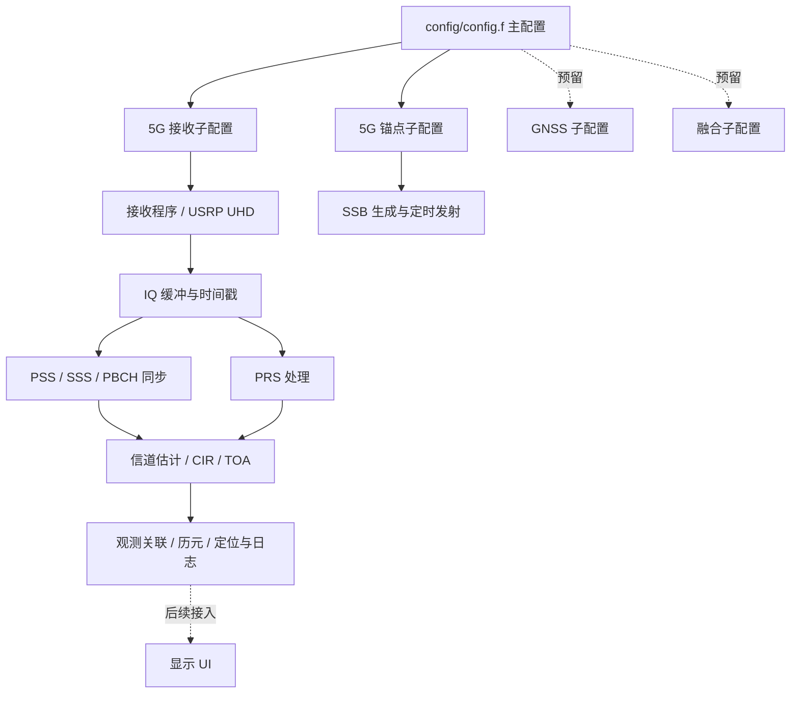

# 北斗—5G 融合定位工程

当前优先维护 5G 接收、SSB 同步与 TOA 测量链路；GNSS 和融合代码保留，默认不参与构建。UI 目录预留。

## 目录

```text
config/
  config.f                 主配置：选择各模块的子配置
  5G/                      接收、锚点、PRS 等子配置及 anchors.csv
  GNSS/                    北斗子配置预留
  fusion/                  融合子配置预留
src/
  5G/
    app/                   接收机与锚点程序入口
    include/               配置、测量与处理接口
    radio/                 USRP/UHD 后端，Lime 历史接口
    positioning/common/    IQ 环形缓冲、时间、配置、观测管理与解算
    positioning/ssb/       PSS/SSS/PBCH、信道估计、SSB TOA
    positioning/prs/       PRS 提取、信道估计与 TOA
    tools/                 离线回放、配置检查、日志处理和实验脚本
    tests/                 离线测试
    third_party/           最小 OAI 依赖、许可及历史兼容文件
    docs/                  5G 使用与整理说明
  GNSS/                    B1C 实现、命令行入口及 MATLAB 参考
  fusion/                  统一观测接口、CSV、适配器与 WLS
ui/                        显示 UI 预留
log/                       运行日志、诊断 CSV、IQ 和本机验证日志（不入 Git）
CMakeLists.txt             统一编译入口
CMakePresets.json          编译预设
```

## 处理框架



## 编译与检查

主要运行平台为 Linux，在线 USRP 链路需要 UHD、pthread、pkg-config、C/C++ 编译器和 CMake。预设使用 Ninja，要求 CMake 3.21 以上；不使用预设时要求 CMake 3.16 以上。

```bash
# 离线算法、回放与测试，不需要 UHD
cmake --preset offline
cmake --build --preset offline --parallel
ctest --preset offline

# 在线接收机、锚点及离线工具，需要安装 UHD 开发包
cmake --preset radio
cmake --build --preset radio --parallel
ctest --preset radio
```

也可直接运行 `cmake -S . -B build/offline -DBDS5G_BUILD_RADIO=OFF`。默认只构建 5G；`BDS5G_BUILD_GNSS` 和 `BDS5G_BUILD_FUSION` 默认均为 OFF。

输出位于 `build/<预设名>/src/5G/`：`nr-config-check`、`replay_toa_iq`、7 个测试程序；radio 预设额外生成 `nr-toa-uesoftmodem` 和 `nr-ssb-anchor`。Windows/MinGW 仅用于离线验证，在线设备链路以 Linux 为准。

## 配置与运行

统一通过 [config/config.f](config/config.f) 选择子配置。每个有效配置项上方都有中文说明和填写示例。子配置路径相对于主配置所在目录，子配置中的 `anchor_db_path` 相对于该子配置所在目录。

```bash
# 不启动设备，检查主配置、所选子配置和锚点表
./build/offline/src/5G/nr-config-check config/config.f receiver
./build/offline/src/5G/nr-config-check config/config.f anchor

# 在线运行，两个程序均接收主配置文件
./build/radio/src/5G/nr-toa-uesoftmodem -O config/config.f
./build/radio/src/5G/nr-ssb-anchor -O config/config.f
```

例如，要使用已有 PCI84 实验参数，只需在主配置设置：

```ini
nr_config = 5G/ue.toa.ssb.usrpb210.n1_422910_pci84.precise.f
```

默认仍选用原始 `ue.toa.ssb.usrpb210` 配置，频率为 3600 MHz。实际实验请选择已经验证的对应配置。GNSS 和融合的配置路径、启用项目前仅预留，5G 程序不会启动这些模块；原有离线演示仍使用自己的命令行参数。

OAI 等依赖说明、实验工具用法见 [5G 说明](src/5G/docs/README.md)，本次调整与验证范围见 [整理记录](src/5G/docs/reorganization.md)。含硬件加速内容的原版本保存在 `codex/fpga-preserved` 分支。

## 日志与 WSL

所有运行日志集中在根目录 `log/`，程序会自动创建所需子目录。接收机延迟 CSV、锚点 `tx_event.csv`、IQ 诊断和启动脚本的标准输出/错误均使用这里；历史采样、日志移至本机 `log/archive/`。整个 `log/` 被 Git 忽略，复制给 Linux 测试电脑时可以按需携带，提交 GitHub 时不包含这些数据。

WSL 的用途是提前做 Linux 编译、离线算法回归和配置检查；实际 USRP 同步、USB 流量与射频性能仍在原 Linux 测试电脑上验证。当前本机 Ubuntu 24.04 WSL 已有 GCC/G++、pkg-config，尚缺 CMake、Ninja 和 UHD 开发库。本次未自动安装系统软件。补齐后可在 WSL 中按上面的 `offline` / `radio` 预设构建；Windows 和 Linux 的构建产物应使用不同目录。

本次已直接使用本机 WSL GCC 13.3 编译并运行 8 项离线测试（含新增日志路径测试及融合 WLS），全部通过；两个在线 C 入口的语法检查、主配置加载、启动脚本的标准输出/错误日志归档检查也通过。WSL 编译产物位于本机 `build/wsl-gcc/`，验证日志位于 `log/build/wsl-gcc-<时间>/`。这不等同于本地已完成 UHD 在线程序的完整链接或射频验证。

补齐 WSL 的开发依赖可在 Ubuntu 内执行 `sudo apt update && sudo apt install cmake ninja-build pkg-config libuhd-dev`。随后使用 `cmake -S . -B build/wsl-offline -G Ninja -DBDS5G_BUILD_RADIO=OFF`、`cmake --build build/wsl-offline --parallel` 和 `ctest --test-dir build/wsl-offline --output-on-failure`；这些命令分别生成构建目录、离线程序和测试结果。下一步再用独立目录 `build/wsl-radio` 开启 `BDS5G_BUILD_RADIO=ON` 验证完整 UHD 编译。
