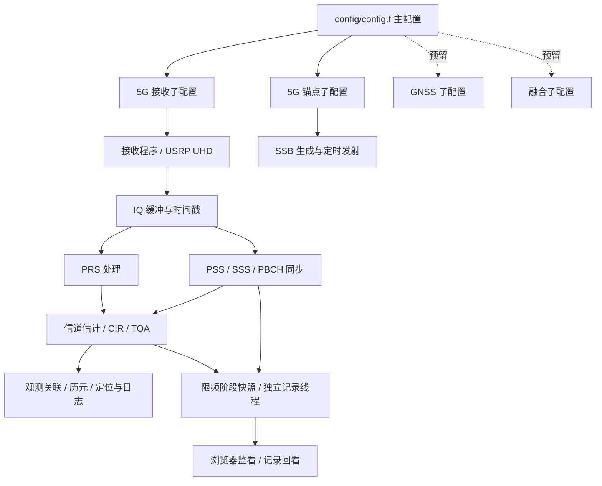

# 北斗—5G 融合定位工程

当前优先维护 5G 接收、SSB 同步与 TOA 测量链路，提供本机浏览器监看与记录回看。GNSS 和融合代码保留，默认不参与构建；三维定位模块暂不实现。

## 目录

```text
config/
  config.f                 主配置：选择各模块的子配置
  5G/                      接收、锚点、PRS 等子配置及 anchors.csv
  GNSS/                    北斗子配置预留
  fusion/                  融合子配置预留
  UI/                      浏览器监看、记录频率与场景声明
src/
  5G/
    app/                   接收机与锚点程序入口
    include/               配置、测量与处理接口
    radio/                 USRP/UHD 后端，Lime 历史接口
    positioning/common/    IQ 环形缓冲、时间、配置、观测管理与解算
    positioning/ssb/       PSS/SSS/PBCH、信道估计、SSB TOA
    positioning/prs/       PRS 提取、信道估计与 TOA
    tools/                 离线回放、配置检查、日志处理和实验脚本
    tests/                 离线测试
    third_party/           最小 OAI 依赖、许可及历史兼容文件
    docs/                  5G 使用与整理说明
  GNSS/                    B1C 实现、命令行入口及 MATLAB 参考
  fusion/                  统一观测接口、CSV、适配器与 WLS
ui/                        三页浏览器 UI、Python 本机服务与回看工具
log/                       运行日志、诊断 CSV、IQ 和本机验证日志（不入 Git）
CMakeLists.txt             统一编译入口
CMakePresets.json          编译预设
run_5G_only.sh                     Linux 一键增量编译与启动
```

## 处理框架



## 编译与检查

主要运行平台为 Linux，在线 USRP 链路需要 UHD、pthread、pkg-config、C/C++ 编译器和 CMake。预设使用 Ninja，要求 CMake 3.21 以上；不使用预设时要求 CMake 3.16 以上。

```bash
# 离线算法、回放与测试，不需要 UHD
cmake --preset offline
cmake --build --preset offline --parallel
ctest --preset offline

# 在线接收机、锚点及离线工具，需要安装 UHD 开发包
cmake --preset radio
cmake --build --preset radio --parallel
ctest --preset radio
```

也可直接运行 `cmake -S . -B build/offline -DBDS5G_BUILD_RADIO=OFF`。默认只构建 5G；`BDS5G_BUILD_GNSS` 和 `BDS5G_BUILD_FUSION` 默认均为 OFF。

输出位于 `build/<预设名>/src/5G/`：`nr-config-check`、`replay_toa_iq`、8 个测试程序；radio 预设额外生成 `nr-toa-uesoftmodem` 和 `nr-ssb-anchor`。找到 Python 3.9+ 时还会注册 UI 服务测试。Windows/MinGW 仅用于离线验证，在线设备链路以 Linux 为准。

## 配置与运行

统一通过 [config/config.f](config/config.f) 选择子配置。每个有效配置项上方都有中文说明和填写示例。子配置路径相对于主配置所在目录，子配置中的 `anchor_db_path` 相对于该子配置所在目录。

```bash
# 不启动设备，检查主配置、所选子配置和锚点表
./build/offline/src/5G/nr-config-check config/config.f receiver
./build/offline/src/5G/nr-config-check config/config.f anchor

# 在线运行，两个程序均接收主配置文件
./build/radio/src/5G/nr-toa-uesoftmodem -O config/config.f
./build/radio/src/5G/nr-ssb-anchor -O config/config.f
```

例如，要使用已有 PCI84 实验参数，只需在主配置设置：

```ini
nr_config = 5G/ue.toa.ssb.usrpb210.n1_422910_pci84.precise.f
```

默认仍选用原始 `ue.toa.ssb.usrpb210` 配置，频率为 3600 MHz。实际实验请选择已经验证的对应配置。GNSS 和融合的配置路径、启用项目前仅预留，5G 程序不会启动这些模块；原有离线演示仍使用自己的命令行参数。

OAI 等依赖说明、实验工具用法见 [5G 说明](src/5G/docs/README.md)，本次调整与验证范围见 [整理记录](src/5G/docs/reorganization.md)。含硬件加速内容的原版本保存在 `codex/fpga-preserved` 分支。

## 浏览器监看

UI 与接收程序运行在同一台 Linux 电脑，共用一个主配置。UI 运行只需要 Python 3.9+ 与现代浏览器，不需要 pip、npm、CDN 或 GPU 算法加速。**本版增加了 C 端监看接口，从旧版升级时需要重新编译接收程序；继续运行旧二进制，无法得到新增的阶段波形。**

已有 Linux/UHD 开发环境后，可在工程根目录执行：

```bash
sh run_5G_only.sh
```

脚本自动读取主配置、按 `radio` 预设增量编译（最多两个并行编译任务）、检查接收配置并启动接收机和 UI。请在本机浏览器打开脚本打印的地址，默认 <http://127.0.0.1:8765>。按 Ctrl+C 停止本次启动的两个进程；任一进程退出时脚本也会停止另一个。终端日志保存在 `log/launcher/<时间>-<进程号>/`，其中 `receiver.log` 为接收输出，`ui.log` 为服务输出；监看记录仍在配置指定的目录。锚点发射程序仍需单独启动。

仅查看历史记录时用 `sh run_5G_only.sh --ui-only`，不编译也不打开设备。脚本不会安装依赖或修改系统；首次缺少开发库时，按下文的 Linux 依赖说明准备环境。

修改已有 `.f` 配置项的值或 `anchors.csv` **无需重新编译**，但配置不支持运行中自动生效：停止并重新启动受影响的接收机或 UI。C/C++ 源码、头文件、CMake 编译选项或链接库发生变化时需要重新构建；增加全新的配置项并让程序识别它，也通常需要修改和重编译对应 C 代码。只修改 Python 服务时重启服务；只修改网页 HTML/CSS/JS 时刷新浏览器（必要时强制刷新）。`run_5G_only.sh` 每次执行增量构建，未变化的 C/C++ 文件会跳过。

先在主配置中选择本次已经验证的 5G 子配置，并保留监看子配置入口：

```ini
nr_config = 5G/ue.toa.ssb.usrpb210.f
ui_config = UI/monitor.f
```

上面的接收配置仅为默认示例，实际测试应改成已经验证的频点与设备配置。完成 `radio` 构建后，在工程根目录分别使用两个终端：

```bash
# 终端一：启动接收与计算，原实验参数仍来自主配置选择的 5G 子配置
./build/radio/src/5G/nr-toa-uesoftmodem -O config/config.f

# 终端二：启动本机只读 UI 服务
python3 ui/server.py --config config/config.f
```

在同一台电脑打开 <http://127.0.0.1:8765>，选择“实时监看”。接收机自动生成 `log/monitor/` 下的 JSONL 文件，本机服务读取新事件并提供给浏览器。两个终端可以按任意顺序启动；自建实验中的锚点发射程序仍按原流程单独运行。

| 页面 | 第一版内容 |
|---|---|
| Summary | 已加载配置、当前磁盘配置、时钟最近报告状态、全部信号锁定状态和采样间断/丢弃计数 |
| SSB Trace | 选中一个频点/PCI/SSB，查看同一事件的 IQ、PSS 相关、信道幅相、CIR 与峰值插值；支持缩放、平移和冻结 |
| Results | 频偏、窗口相对时延、均值与标准差；满足条件的绝对 TOA 与距离；位置坐标仅保留接口 |

第一版只监看，不修改配置、不启停接收程序。冻结画面或关闭网页不会停止接收与记录；按 Ctrl+C 分别停止两个终端。历史记录支持分页、逐条查看和播放，不重新计算 IQ。捕获和测量发生在不同事件时，未执行阶段保持空白，不拼接为一次完整解算。

主配置的 `ui_config` 选择 [监看子配置](config/UI/monitor.f)。默认开启记录，状态间隔 200 ms、阶段快照间隔 1000 ms；每段默认 128 MiB，单次实验保留 8 段轮换。不同实验互不覆盖，旧实验总占用需自行管理；整个 `log/` 不入 Git。

信号来源支持自建 `controlled`（默认）和现网 `commercial`；时间模型支持收发共同时间基准 `shared`（默认）和仅基站同步 `receiver_bias`。这些选项仅声明场景，不自动配置设备时钟。绝对时延标定默认未确认（`absolute_toa_calibrated = 0`）；底层有效测量、事件时钟状态、时间模型与标定等条件未满足时，TOA/距离显示不可用及原因。窗口相对时延不能直接作为传播距离。

无硬件时可生成明确标注的演示记录：

```bash
python3 ui/make_demo.py --config config/config.f
python3 ui/server.py --config config/config.f
```

浏览器选择“记录回看”并载入 `[演示] demo-...jsonl`。演示不会进入实时源，也不代表射频或定位实测通过。完整启动、文件管理和检查方法见 [UI 使用说明](ui/README.md)，数据格式与扩展边界见 [监看协议](ui/protocol.md)。

## 本版验证与边界

- 本机 Windows/MinGW/Ninja 完成包含 GNSS、融合和监看模块的离线构建，10 项 CTest 通过；其中 UI 服务测试包含 7 个 Python 用例。
- 4 项原算法测试（SSB 同步、SSB TOA、PRS TOA、解算）的输出与修改前基线逐字节一致。
- 本机 Chromium 检查覆盖页面切换、单信号 Trace、缩放、回看分页与播放、失锁、冻结/恢复，以及含钟差或未标定时不显示绝对距离。
- GitHub Actions 配置了 Linux `offline`、`radio`、`all-offline` 构建/测试与独立浏览器检查。
- GNSS UI、三维定位算法、参数编辑/设备控制、逐次搜索调试和 IQ 重算暂未实现。连续 SSB 接收与 UI 开销仍需在目标 Linux/USRP 环境实测。

## 日志与 WSL

所有运行日志集中在根目录 `log/`，程序会自动创建所需子目录。接收机延迟 CSV、锚点 `tx_event.csv`、IQ 诊断和启动脚本的标准输出/错误均使用这里；历史采样、日志移至本机 `log/archive/`。整个 `log/` 被 Git 忽略，复制给 Linux 测试电脑时可以按需携带，提交 GitHub 时不包含这些数据。

WSL 的用途是提前做 Linux 编译、离线算法回归和配置检查；实际 USRP 同步、USB 流量与射频性能仍在原 Linux 测试电脑上验证。当前本机 Ubuntu 24.04 WSL 已有 GCC/G++、pkg-config，尚缺 CMake、Ninja 和 UHD 开发库。本次未自动安装系统软件。补齐后可在 WSL 中按上面的 `offline` / `radio` 预设构建；Windows 和 Linux 的构建产物应使用不同目录。

此前日志整理阶段已直接使用本机 WSL GCC 13.3 编译并运行 8 项离线测试（含日志路径测试及融合 WLS），全部通过；两个在线 C 入口的语法检查、主配置加载、启动脚本的标准输出/错误日志归档检查也通过。这是 UI 增加之前的验证记录，不能替代本版 UI 的 Linux 实机检查。对应编译产物位于本机 `build/wsl-gcc/`，验证日志位于 `log/build/wsl-gcc-<时间>/`。

补齐 WSL 的开发依赖可在 Ubuntu 内执行 `sudo apt update && sudo apt install cmake ninja-build pkg-config libuhd-dev`。随后使用 `cmake -S . -B build/wsl-offline -G Ninja -DBDS5G_BUILD_RADIO=OFF`、`cmake --build build/wsl-offline --parallel` 和 `ctest --test-dir build/wsl-offline --output-on-failure`；这些命令分别生成构建目录、离线程序和测试结果。下一步再用独立目录 `build/wsl-radio` 开启 `BDS5G_BUILD_RADIO=ON` 验证完整 UHD 编译。
