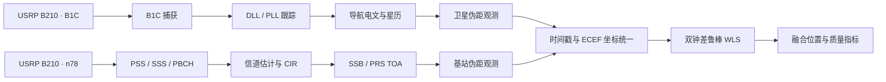

# 北斗 B1C—5G NR 融合定位架构

> 下面描述融合目标架构。当前在线主链路为 5G；GNSS、统一观测适配和融合仍为独立离线模块，尚未由主配置统一调度。

## 数据流



## 模块边界

- `src/GNSS/bds_b1c`：B1C 码、捕获、跟踪和导航消息处理。
- `src/5G/positioning`：原有 NR SSB/PRS TOA 信号处理实现。
- `src/fusion/adapters`：将 NR TOA、PCI、锚点和标定延迟转换为公共观测量。
- `src/fusion`：同时估计接收机 ECEF 坐标、北斗钟差和 NR 钟差。
- `src/fusion/app`：不依赖 UHD 的离线融合演示入口。

## 公共观测模型

对第 `i` 个信号源，观测方程为：

```text
rho_i = ||receiver_ecef - source_ecef_i|| + clock_bias(system_i) + error_i
```

北斗与 5G 使用独立钟差状态，避免把两台 B210 或两个系统之间的时间偏差错误吸收到位置结果中。权重由各观测的 `sigma_m` 给出，并使用 Huber 权抑制离群测量。

## 硬件接口

在线实验计划使用两台 USRP B210。两台设备必须共享 10 MHz 与 PPS；主机 USB 接收时间不参与精密 TOA 计算，统一使用 UHD 硬件时间戳。
