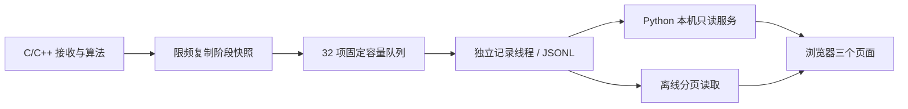

# 5G / 北斗浏览器监看

同一台电脑上运行本机只读服务，使用浏览器查看。运行 UI 只需要 Python 3.9+，不依赖 pip、npm、CDN 或网络；没有接收机也可以查看历史记录。左侧可切换 **5G NR** 与 **北斗 B1C**：5G 支持实时监看和记录回看，北斗支持现有离线处理结果导入与回放。北斗在线输入、设备控制、配置编辑、逐次搜索调试、IQ 重算和 5G/融合定位界面尚未实现。

北斗的导入、页面与时间含义见 [北斗 UI 使用说明](gnss.md)。本机已有参考实验时，启动下述服务后选择“北斗 B1C”即可；无需启动 5G 接收机。

两个模块有各自的 Linux 入口：`sh run_5G_only.sh` 启动 5G 接收与 UI（默认 8765）；`sh run_BDS_only.sh` 执行北斗离线完整链路后启动北斗 UI（默认 8766）。两个脚本均支持 `--ui-only` 只查看已有记录，北斗从自己的脚本启动时会直接进入北斗页面。

## 运行

在仓库根目录执行：

```bash
# Linux 一键增量编译并启动接收机与 UI；需要已安装 UHD 等开发依赖
sh run_5G_only.sh

# 只启动 UI 查看历史记录，无需 UHD 或编译
sh run_5G_only.sh --ui-only
```

默认模式下，按 Ctrl+C 同时停止本次启动的接收机与 UI；终端日志写入 `log/launcher/<时间>-<进程号>/`。打开脚本输出的本机地址即可，不会自动启动浏览器。修改配置后重新执行脚本，无需手动完整重编译。以下两终端启动方式仍可使用：

```bash
# 1. 编译包含监看接口的接收程序（需要已有 UHD 开发环境）
cmake --preset radio
cmake --build --preset radio --parallel

# 2. 一个终端启动原接收程序，输入仍是主配置
./build/radio/src/5G/nr-toa-uesoftmodem -O config/config.f

# 3. 另一个终端启动浏览器服务
python3 ui/server.py --config config/config.f
```

打开 <http://127.0.0.1:8765>。接收程序正常启动后，UI 自动读取它生成的记录。两个程序可以按任意顺序启动；UI 冻结、切换页面、关闭浏览器均不会控制接收机。按 Ctrl+C 分别停止各终端。也可运行 `cmake --build build/radio --target nr-monitor-ui` 启动服务。

主配置的 `ui_config = UI/monitor.f` 相对于主配置目录解析。端口、刷新率、记录频率、记录目录、保留数量和场景声明均在该子配置中，逐项有中文说明和例子；`record_dir` 相对于仓库 `log/`。修改后重启相应服务/接收程序。缺少 `ui_config` 的旧主配置不会启用 C 端记录；网页服务不能单独从终端文本日志还原未记录的阶段波形。

输出：`log/monitor/run-<时间>-<进程号>-<段号>.jsonl`。每段默认 128 MiB，单次实验最多保留 8 段并轮换覆盖本次最旧段。不同实验互不覆盖，需要人工管理旧实验总占用。服务内存仅保留最近的测量摘要和每个信号最新快照；回看分页读取仍保留在磁盘上的记录。

## 无硬件预览

```bash
python3 ui/make_demo.py --config config/config.f
python3 ui/server.py --config config/config.f
```

浏览器中选择“记录回看”，从实验/分段列表选择 `[演示] demo-...jsonl`，拖动时间轴查看。演示包含两个信号及一次失锁，仅用于检查 UI；页面始终标注“非实测”，演示文件不会成为实时监看源。

## 5G 的三个页面

- **Summary**：各条目的锁定与更新状态、采样率、配置快照、设备时钟的最近报告状态、采样间断与监看丢弃计数。磁盘配置与实验保存的已加载值分别展示；修改磁盘文件不会改变已保存的实验配置。
- **SSB Trace**：选择一个频点/PCI/SSB 条目，显示同一事件的 IQ、PSS 相关功率、PBCH 符号 1 的信道幅相、CIR、峰值邻域和插值结果。支持缩放、平移、冻结。相关与 CIR 曲线分桶保峰显示，IQ 为抽点显示；坐标使用原始采样/子载波索引。搜索步长记录算法实际值，UI 不更改步长。
- **Results**：测量结果、TOA 与距离、位置坐标三个区域。位置坐标接口固定返回无效和 `xyz_m: null`，不显示默认零坐标。

已有流程中，全局 PSS 搜索发生在捕获阶段，信道/CIR/时延发生在后续测量阶段。因此单个真实事件通常只具备部分曲线；页面明确保留缺失阶段，不拼接不同时刻的数据。捕获过程可从保存的记录回看；第一版不记录每个频偏/时间候选的完整调试轨迹。

## 结果含义

信号来源 `controlled`（默认自建）/`commercial`（现网）与时间模型 `shared`（默认收发共同时间基准）/`receiver_bias`（仅基站同步）可在配置文件中选择，第一版 UI 只读展示这些声明。它们不会配置实际设备时钟，也不使现网自动具备测距条件。

窗口相对时延包含采样窗口与跟踪偏移，不能直接作为传播时延或距离。绝对 TOA 显示要求：该事件保持真实锁定、底层测量有效、存在有效 TOA 候选、事件报告时钟锁定、时间模型为 shared，且操作者已经独立确认发射时间和固定硬件延迟标定（`absolute_toa_calibrated = 1`）。默认该标记为 0。满足这些已声明条件才将 TOA 换算成距离；页面不声称替代物理标定或射频验证。

仅基站同步时，界面标注接收机钟差原因，不把候选值当作绝对距离。三个完全同步基站、四个仅基站同步等定位模型留给未来定位模块；不在 UI 中写死基站数量规则。多个 SSB 波束也不自动视作多个独立定位锚点。

## 数据与性能边界



算法调用不会等待浏览器或磁盘；队列竞争/满时跳过监看事件并累加 dropped，不丢弃算法 IQ。状态默认最小间隔 200 ms，详细阶段每个已配置扫描目标默认最小间隔 1000 ms；宽带扫频更换频点不会绕过间隔。每条曲线最多 512 个点；浏览器图表最多约每 500 ms 更新。前端冻结只暂停显示，服务和记录线程继续工作。

这些限制是工程上限，不是实机算力保证。i7-10750H/16GB 目标机还需要在同一信号条件下比较：监看关闭、仅状态、状态加波形三种情况的 CPU/内存、采样间断、同步任务丢弃、锁定与失锁情况。当前没有使用 RTX 2060 进行接收算法加速。

## 检查

```bash
# 不需要 UHD，构建 C 测试与记录测试
cmake --preset offline
cmake --build --preset offline --parallel
ctest --preset offline

# 单独检查 Python 服务
python3 -m unittest discover -s ui/tests -v

# 可选浏览器检查；这些 npm 依赖只用于开发验证
npm install --prefix ui/tests
ui/tests/node_modules/.bin/playwright install chromium
python3 ui/make_demo.py
python3 ui/server.py
# 另一终端运行；输出到 build/playwright/
node ui/tests/browser_smoke.cjs http://127.0.0.1:8765
```

预期：C 测试、Python 服务测试通过，浏览器检查输出 PASS，并生成三个页面截图。下一步在原 Linux/UHD 环境用真实 SSB 信号验证，不用演示数据认定定位或接收性能通过。

接口细节见 [protocol.md](protocol.md)。
